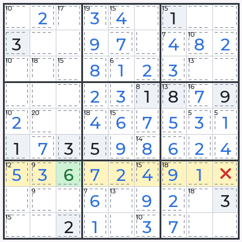

<!-- Written by tools/walkthrough.py killer: edit the script, not this page. -->
# Killer, step 42: the 6 in row 7

**Step 42 of 71** · [← Step 41](step-41.md) · [All steps](../killer.md#the-whole-puzzle-step-by-step) · [Step 43 →](step-43.md)

Row 7 needs a 6. r7c9: the cage of 18 (with 9 and 1 already in it) needs 8 there. Only **r7c3** is left: **r7c3 = 6**.

**Step 42 of 71** · [← Step 41](step-41.md) · [All steps](../killer.md#the-whole-puzzle-step-by-step) · [Step 43 →](step-43.md)
