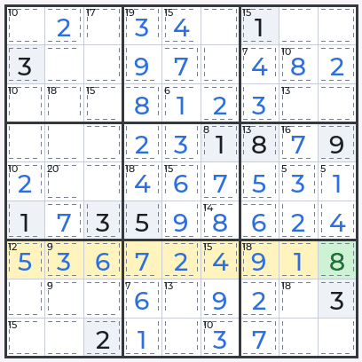

<!-- Written by tools/walkthrough.py killer: edit the script, not this page. -->
# Killer, step 43: the 8 in row 7

**Step 43 of 71** · [← Step 42](step-42.md) · [All steps](../killer.md#the-whole-puzzle-step-by-step) · [Step 44 →](step-44.md)

Row 7 needs an 8, and r7c9 is its last empty cell: **r7c9 = 8**.

**Step 43 of 71** · [← Step 42](step-42.md) · [All steps](../killer.md#the-whole-puzzle-step-by-step) · [Step 44 →](step-44.md)
