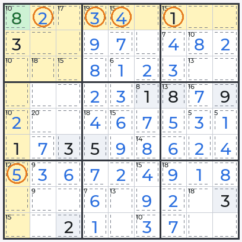

<!-- Written by tools/walkthrough.py killer: edit the script, not this page. -->
# Killer, step 44: r1c1

**Step 44 of 71** · [← Step 43](step-43.md) · [All steps](../killer.md#the-whole-puzzle-step-by-step) · [Step 45 →](step-45.md)

Row 1 has 1, 2, 3 and 4; column 1 has 5. Not 6, 7 or 9: the cage of 10 (with 2 already in it) needs 8 there. Only 8 is left: **r1c1 = 8**.

**Step 44 of 71** · [← Step 43](step-43.md) · [All steps](../killer.md#the-whole-puzzle-step-by-step) · [Step 45 →](step-45.md)
