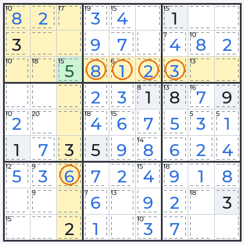

<!-- Written by tools/walkthrough.py killer: edit the script, not this page. -->
# Killer, step 45: r3c3

**Step 45 of 71** · [← Step 44](step-44.md) · [All steps](../killer.md#the-whole-puzzle-step-by-step) · [Step 46 →](step-46.md)

Row 3 has 1, 2, 3 and 8; column 3 has 6. Not 4, 7 or 9: the cage of 15 (with 8 and 2 already in it) needs 5 there. Only 5 is left: **r3c3 = 5**.

**Step 45 of 71** · [← Step 44](step-44.md) · [All steps](../killer.md#the-whole-puzzle-step-by-step) · [Step 46 →](step-46.md)
