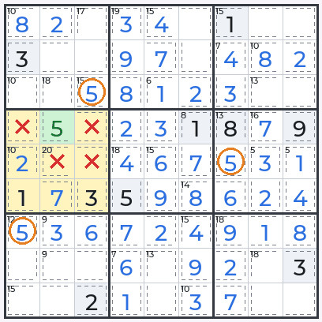

<!-- Written by tools/walkthrough.py killer: edit the script, not this page. -->
# Killer, step 46: the 5 in box 4

**Step 46 of 71** · [← Step 45](step-45.md) · [All steps](../killer.md#the-whole-puzzle-step-by-step) · [Step 47 →](step-47.md)

Box 4 needs a 5. r4c1: column 1 has one (r7c1). r4c3: column 3 has one (r3c3). r5c2 and r5c3: row 5 has one (r5c7). Only **r4c2** is left: **r4c2 = 5**.

**Step 46 of 71** · [← Step 45](step-45.md) · [All steps](../killer.md#the-whole-puzzle-step-by-step) · [Step 47 →](step-47.md)
