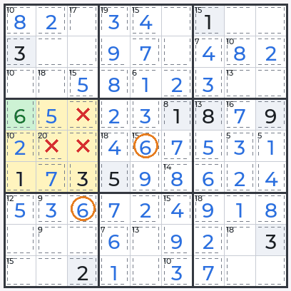

<!-- Written by tools/walkthrough.py killer: edit the script, not this page. -->
# Killer, step 47: the 6 in box 4

**Step 47 of 71** · [← Step 46](step-46.md) · [All steps](../killer.md#the-whole-puzzle-step-by-step) · [Step 48 →](step-48.md)

Box 4 needs a 6. r4c3: column 3 has one (r7c3). r5c2 and r5c3: row 5 has one (r5c5). Only **r4c1** is left: **r4c1 = 6**.

**Step 47 of 71** · [← Step 46](step-46.md) · [All steps](../killer.md#the-whole-puzzle-step-by-step) · [Step 48 →](step-48.md)
