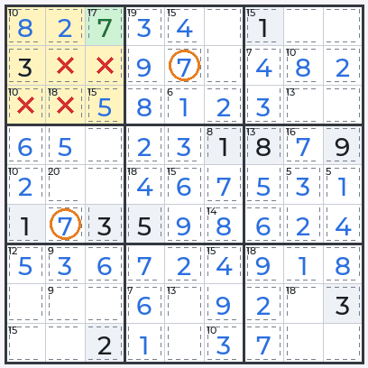

<!-- Written by tools/walkthrough.py killer: edit the script, not this page. -->
# Killer, step 48: the 7 in box 1

**Step 48 of 71** · [← Step 47](step-47.md) · [All steps](../killer.md#the-whole-puzzle-step-by-step) · [Step 49 →](step-49.md)

Box 1 needs a 7. r2c2 and r2c3: row 2 has one (r2c5). r3c2: column 2 has one (r6c2). r3c1: the cage of 10 (with 6 already in it) needs 4 there. Only **r1c3** is left: **r1c3 = 7**.

**Step 48 of 71** · [← Step 47](step-47.md) · [All steps](../killer.md#the-whole-puzzle-step-by-step) · [Step 49 →](step-49.md)
