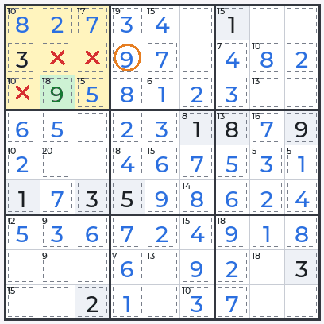

<!-- Written by tools/walkthrough.py killer: edit the script, not this page. -->
# Killer, step 49: the 9 in box 1

**Step 49 of 71** · [← Step 48](step-48.md) · [All steps](../killer.md#the-whole-puzzle-step-by-step) · [Step 50 →](step-50.md)

Box 1 needs a 9. r2c2 and r2c3: row 2 has one (r2c4). r3c1: the cage of 10 (with 6 already in it) needs 4 there. Only **r3c2** is left: **r3c2 = 9**.

**Step 49 of 71** · [← Step 48](step-48.md) · [All steps](../killer.md#the-whole-puzzle-step-by-step) · [Step 50 →](step-50.md)
