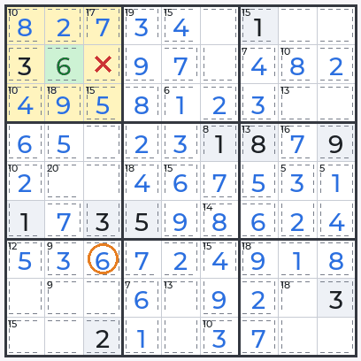

<!-- Written by tools/walkthrough.py killer: edit the script, not this page. -->
# Killer, step 51: the 6 in box 1

**Step 51 of 71** · [← Step 50](step-50.md) · [All steps](../killer.md#the-whole-puzzle-step-by-step) · [Step 52 →](step-52.md)

Box 1 needs a 6. r2c3: column 3 has one (r7c3). Only **r2c2** is left: **r2c2 = 6**.

**Step 51 of 71** · [← Step 50](step-50.md) · [All steps](../killer.md#the-whole-puzzle-step-by-step) · [Step 52 →](step-52.md)
