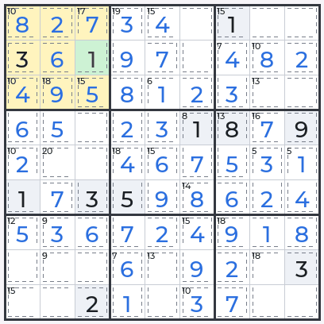

<!-- Written by tools/walkthrough.py killer: edit the script, not this page. -->
# Killer, step 52: the 1 in box 1

**Step 52 of 71** · [← Step 51](step-51.md) · [All steps](../killer.md#the-whole-puzzle-step-by-step) · [Step 53 →](step-53.md)

Box 1 needs a 1, and r2c3 is its last empty cell: **r2c3 = 1**.

**Step 52 of 71** · [← Step 51](step-51.md) · [All steps](../killer.md#the-whole-puzzle-step-by-step) · [Step 53 →](step-53.md)
