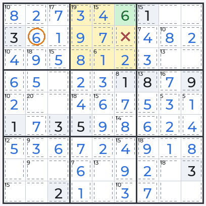

<!-- Written by tools/walkthrough.py killer: edit the script, not this page. -->
# Killer, step 53: the 6 in box 2

**Step 53 of 71** · [← Step 52](step-52.md) · [All steps](../killer.md#the-whole-puzzle-step-by-step) · [Step 54 →](step-54.md)

Box 2 needs a 6. r2c6: row 2 has one (r2c2). Only **r1c6** is left: **r1c6 = 6**.

**Step 53 of 71** · [← Step 52](step-52.md) · [All steps](../killer.md#the-whole-puzzle-step-by-step) · [Step 54 →](step-54.md)
