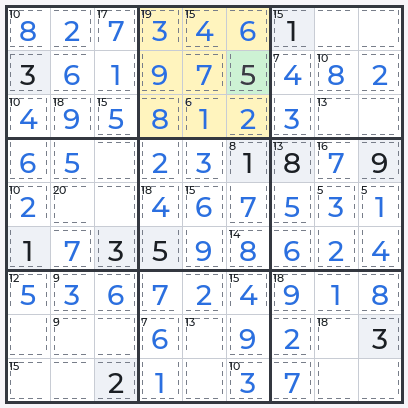

<!-- Written by tools/walkthrough.py killer: edit the script, not this page. -->
# Killer, step 54: the 5 in box 2

**Step 54 of 71** · [← Step 53](step-53.md) · [All steps](../killer.md#the-whole-puzzle-step-by-step) · [Step 55 →](step-55.md)

Box 2 needs a 5, and r2c6 is its last empty cell: **r2c6 = 5**.

**Step 54 of 71** · [← Step 53](step-53.md) · [All steps](../killer.md#the-whole-puzzle-step-by-step) · [Step 55 →](step-55.md)
