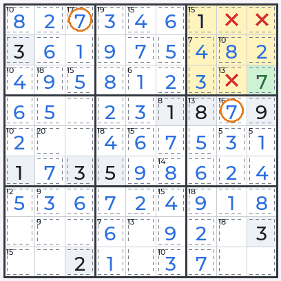

<!-- Written by tools/walkthrough.py killer: edit the script, not this page. -->
# Killer, step 55: the 7 in box 3

**Step 55 of 71** · [← Step 54](step-54.md) · [All steps](../killer.md#the-whole-puzzle-step-by-step) · [Step 56 →](step-56.md)

Box 3 needs a 7. r1c8 and r1c9: row 1 has one (r1c3). r3c8: column 8 has one (r4c8). Only **r3c9** is left: **r3c9 = 7**.

**Step 55 of 71** · [← Step 54](step-54.md) · [All steps](../killer.md#the-whole-puzzle-step-by-step) · [Step 56 →](step-56.md)
