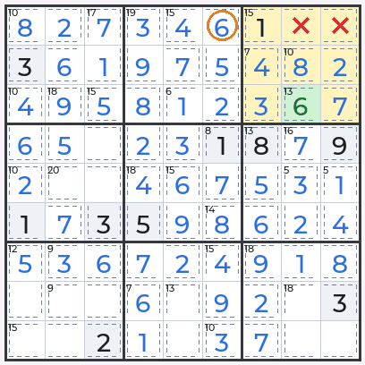

<!-- Written by tools/walkthrough.py killer: edit the script, not this page. -->
# Killer, step 56: the 6 in box 3

**Step 56 of 71** · [← Step 55](step-55.md) · [All steps](../killer.md#the-whole-puzzle-step-by-step) · [Step 57 →](step-57.md)

Box 3 needs a 6. r1c8 and r1c9: row 1 has one (r1c6). Only **r3c8** is left: **r3c8 = 6**.

**Step 56 of 71** · [← Step 55](step-55.md) · [All steps](../killer.md#the-whole-puzzle-step-by-step) · [Step 57 →](step-57.md)
