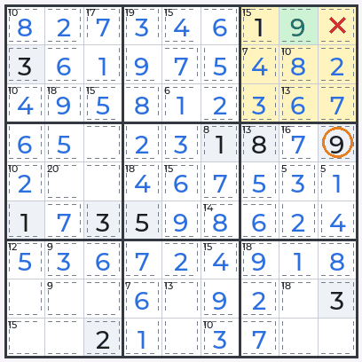

<!-- Written by tools/walkthrough.py killer: edit the script, not this page. -->
# Killer, step 57: the 9 in box 3

**Step 57 of 71** · [← Step 56](step-56.md) · [All steps](../killer.md#the-whole-puzzle-step-by-step) · [Step 58 →](step-58.md)

Box 3 needs a 9. r1c9: column 9 has one (r4c9). Only **r1c8** is left: **r1c8 = 9**.

**Step 57 of 71** · [← Step 56](step-56.md) · [All steps](../killer.md#the-whole-puzzle-step-by-step) · [Step 58 →](step-58.md)
