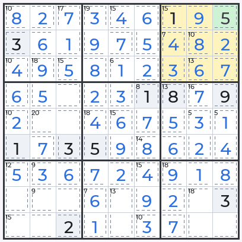

<!-- Written by tools/walkthrough.py killer: edit the script, not this page. -->
# Killer, step 58: the 5 in box 3

**Step 58 of 71** · [← Step 57](step-57.md) · [All steps](../killer.md#the-whole-puzzle-step-by-step) · [Step 59 →](step-59.md)

Box 3 needs a 5, and r1c9 is its last empty cell: **r1c9 = 5**.

**Step 58 of 71** · [← Step 57](step-57.md) · [All steps](../killer.md#the-whole-puzzle-step-by-step) · [Step 59 →](step-59.md)
