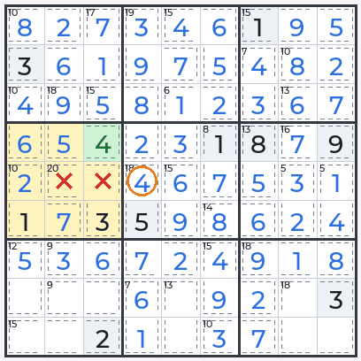

<!-- Written by tools/walkthrough.py killer: edit the script, not this page. -->
# Killer, step 59: the 4 in box 4

**Step 59 of 71** · [← Step 58](step-58.md) · [All steps](../killer.md#the-whole-puzzle-step-by-step) · [Step 60 →](step-60.md)

Box 4 needs a 4. r5c2 and r5c3: row 5 has one (r5c4). Only **r4c3** is left: **r4c3 = 4**.

**Step 59 of 71** · [← Step 58](step-58.md) · [All steps](../killer.md#the-whole-puzzle-step-by-step) · [Step 60 →](step-60.md)
