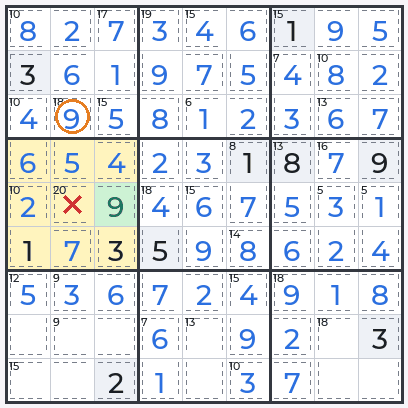

<!-- Written by tools/walkthrough.py killer: edit the script, not this page. -->
# Killer, step 60: the 9 in box 4

**Step 60 of 71** · [← Step 59](step-59.md) · [All steps](../killer.md#the-whole-puzzle-step-by-step) · [Step 61 →](step-61.md)

Box 4 needs a 9. r5c2: column 2 has one (r3c2). Only **r5c3** is left: **r5c3 = 9**.

**Step 60 of 71** · [← Step 59](step-59.md) · [All steps](../killer.md#the-whole-puzzle-step-by-step) · [Step 61 →](step-61.md)
