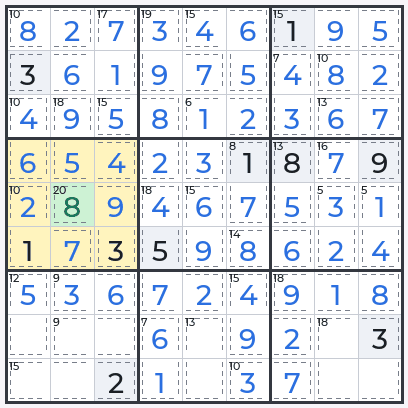

<!-- Written by tools/walkthrough.py killer: edit the script, not this page. -->
# Killer, step 61: the 8 in box 4

**Step 61 of 71** · [← Step 60](step-60.md) · [All steps](../killer.md#the-whole-puzzle-step-by-step) · [Step 62 →](step-62.md)

Box 4 needs an 8, and r5c2 is its last empty cell: **r5c2 = 8**.

**Step 61 of 71** · [← Step 60](step-60.md) · [All steps](../killer.md#the-whole-puzzle-step-by-step) · [Step 62 →](step-62.md)
