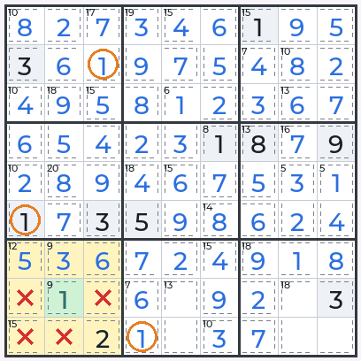

<!-- Written by tools/walkthrough.py killer: edit the script, not this page. -->
# Killer, step 62: the 1 in box 7

**Step 62 of 71** · [← Step 61](step-61.md) · [All steps](../killer.md#the-whole-puzzle-step-by-step) · [Step 63 →](step-63.md)

Box 7 needs a 1. r8c1: column 1 has one (r6c1). r8c3: column 3 has one (r2c3). r9c1 and r9c2: row 9 has one (r9c4). Only **r8c2** is left: **r8c2 = 1**.

**Step 62 of 71** · [← Step 61](step-61.md) · [All steps](../killer.md#the-whole-puzzle-step-by-step) · [Step 63 →](step-63.md)
