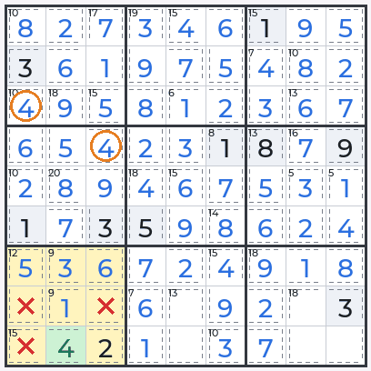

<!-- Written by tools/walkthrough.py killer: edit the script, not this page. -->
# Killer, step 63: the 4 in box 7

**Step 63 of 71** · [← Step 62](step-62.md) · [All steps](../killer.md#the-whole-puzzle-step-by-step) · [Step 64 →](step-64.md)

Box 7 needs a 4. r8c1 and r9c1: column 1 has one (r3c1). r8c3: column 3 has one (r4c3). Only **r9c2** is left: **r9c2 = 4**.

**Step 63 of 71** · [← Step 62](step-62.md) · [All steps](../killer.md#the-whole-puzzle-step-by-step) · [Step 64 →](step-64.md)
