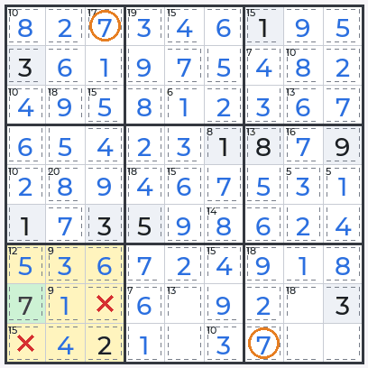

<!-- Written by tools/walkthrough.py killer: edit the script, not this page. -->
# Killer, step 64: the 7 in box 7

**Step 64 of 71** · [← Step 63](step-63.md) · [All steps](../killer.md#the-whole-puzzle-step-by-step) · [Step 65 →](step-65.md)

Box 7 needs a 7. r8c3: column 3 has one (r1c3). r9c1: row 9 has one (r9c7). Only **r8c1** is left: **r8c1 = 7**.

**Step 64 of 71** · [← Step 63](step-63.md) · [All steps](../killer.md#the-whole-puzzle-step-by-step) · [Step 65 →](step-65.md)
