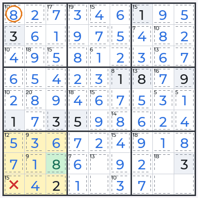

<!-- Written by tools/walkthrough.py killer: edit the script, not this page. -->
# Killer, step 65: the 8 in box 7

**Step 65 of 71** · [← Step 64](step-64.md) · [All steps](../killer.md#the-whole-puzzle-step-by-step) · [Step 66 →](step-66.md)

Box 7 needs an 8. r9c1: column 1 has one (r1c1). Only **r8c3** is left: **r8c3 = 8**.

**Step 65 of 71** · [← Step 64](step-64.md) · [All steps](../killer.md#the-whole-puzzle-step-by-step) · [Step 66 →](step-66.md)
