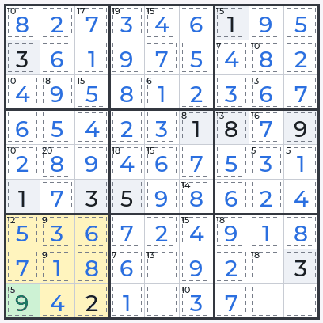

<!-- Written by tools/walkthrough.py killer: edit the script, not this page. -->
# Killer, step 66: the 9 in box 7

**Step 66 of 71** · [← Step 65](step-65.md) · [All steps](../killer.md#the-whole-puzzle-step-by-step) · [Step 67 →](step-67.md)

Box 7 needs a 9, and r9c1 is its last empty cell: **r9c1 = 9**.

**Step 66 of 71** · [← Step 65](step-65.md) · [All steps](../killer.md#the-whole-puzzle-step-by-step) · [Step 67 →](step-67.md)
