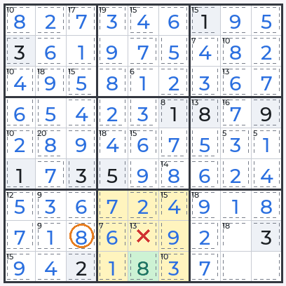

<!-- Written by tools/walkthrough.py killer: edit the script, not this page. -->
# Killer, step 67: the 8 in box 8

**Step 67 of 71** · [← Step 66](step-66.md) · [All steps](../killer.md#the-whole-puzzle-step-by-step) · [Step 68 →](step-68.md)

Box 8 needs an 8. r8c5: row 8 has one (r8c3). Only **r9c5** is left: **r9c5 = 8**.

**Step 67 of 71** · [← Step 66](step-66.md) · [All steps](../killer.md#the-whole-puzzle-step-by-step) · [Step 68 →](step-68.md)
