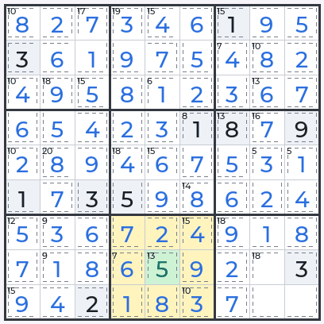

<!-- Written by tools/walkthrough.py killer: edit the script, not this page. -->
# Killer, step 68: the 5 in box 8

**Step 68 of 71** · [← Step 67](step-67.md) · [All steps](../killer.md#the-whole-puzzle-step-by-step) · [Step 69 →](step-69.md)

Box 8 needs a 5, and r8c5 is its last empty cell: **r8c5 = 5**.

**Step 68 of 71** · [← Step 67](step-67.md) · [All steps](../killer.md#the-whole-puzzle-step-by-step) · [Step 69 →](step-69.md)
