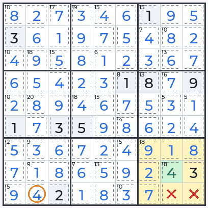

<!-- Written by tools/walkthrough.py killer: edit the script, not this page. -->
# Killer, step 69: the 4 in box 9

**Step 69 of 71** · [← Step 68](step-68.md) · [All steps](../killer.md#the-whole-puzzle-step-by-step) · [Step 70 →](step-70.md)

Box 9 needs a 4. r9c8 and r9c9: row 9 has one (r9c2). Only **r8c8** is left: **r8c8 = 4**.

**Step 69 of 71** · [← Step 68](step-68.md) · [All steps](../killer.md#the-whole-puzzle-step-by-step) · [Step 70 →](step-70.md)
