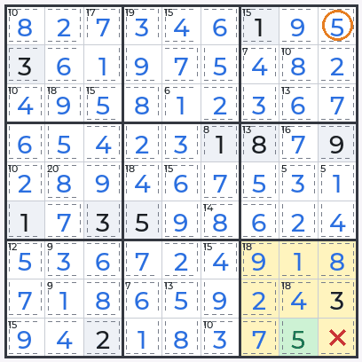

<!-- Written by tools/walkthrough.py killer: edit the script, not this page. -->
# Killer, step 70: the 5 in box 9

**Step 70 of 71** · [← Step 69](step-69.md) · [All steps](../killer.md#the-whole-puzzle-step-by-step) · [Step 71 →](step-71.md)

Box 9 needs a 5. r9c9: column 9 has one (r1c9). Only **r9c8** is left: **r9c8 = 5**.

**Step 70 of 71** · [← Step 69](step-69.md) · [All steps](../killer.md#the-whole-puzzle-step-by-step) · [Step 71 →](step-71.md)
