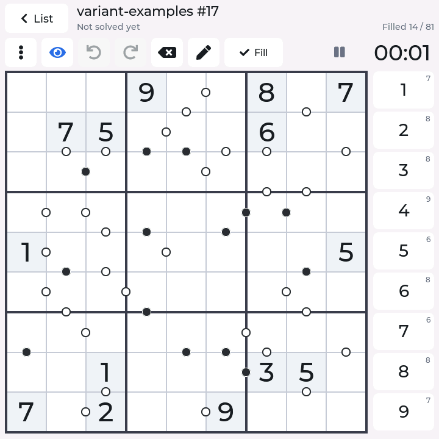
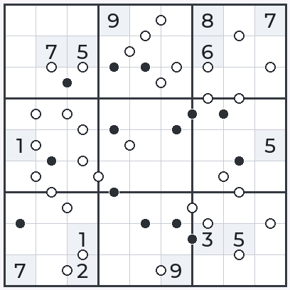

# Kropki

[← All variants](README.md) · [Puzzles](../features-puzzles.md) · [How to play](../how-to-play.md)

## The rules

[Classic](classic.md) rules, and **dots** on the lines between side-by-side cells:

- a **white dot**: the two digits are **1 apart** (3 and 4);
- a **black dot**: one digit is **double** the other (3 and 6).

**Every dot is shown**, so where there's **no dot**, the two digits are neither 1 apart nor one double the other. 1 and 2 are both, so they get either colour.

## On the board

- White dots (with a dark rim) and black dots sit on the grid lines between cells.
- Two digits that break a dot, or a missing dot, turn red.
- The grader and hints narrow each cell by its neighbours across the dots: "The dots around row 3, column 4 (and where there are none) leave it only 2, 6".
- **Puzzles → ⋮ → New puzzle → Kropki**. The dots carry most of the puzzle: Easy keeps about 15 givens, Expert often none at all.

## How to solve it

- **Black dot pairs** are few: 1–2, 2–4, 3–6, 4–8. A cell on a black dot is never 5, 7 or 9.
- **White dot next to a digit:** two choices (next to a 7: 6 or 8).
- **No dot next to a digit** rules out up to four digits: next to a 3 with no dot, the cell isn't 2, 4 (1 apart) or 6 (double); next to a 4, not 3, 5, 2 or 8.
- A cell with no dots at all around it, among filled neighbours, loses many candidates at once.

## Worked example

**variant-examples #17**, Kropki Easy (see [Classic](classic.md#worked-example-the-whole-puzzle) for how to import the examples; cells are written r*row*c*column*). The dots are in the screenshot.

**Step 1: r9c7, with no dot to the 3 above it.** Row 9 has 7, 2 and 9; column 7 has 8, 6 and 3; box 9 has 3 and 5. By the Classic rules r9c7 could be 1 or 4. The cell above, r8c7, is a 3, and there's **no dot** between them: so r9c7 isn't 4 (1 apart from 3), nor 2 or 6. **r9c7 = 1**.

**Step 2: r1c3, with no dots around it.** Row 1 has 9, 8 and 7; column 3 has 5, 1 and 2; box 1 has 7 and 5. That leaves 3, 4 and 6. The cell below, r2c3, is a 5, with **no dot**: so r1c3 isn't 4 or 6. **r1c3 = 3**.

**Step 3: the 1 in column 2.** Column 2 needs a 1:

- r4c2, r5c2, r6c2: box 4 has a 1 (r5c1).
- r7c2, r8c2: box 7 and row 8 have a 1 (r8c3).
- r9c2: row 9 now has the 1 from step 1.
- r3c2: there's a **white dot** between it and the 7 above (r2c2), so it's 6 or 8, not 1.

Only **r1c2** is left: **r1c2 = 1**. Notice that r1c2 (1) and r1c3 (3) have no dot between them, as they shouldn't: 1 and 3 are neither 1 apart nor double.

## The whole puzzle, step by step

<!-- walkthrough -->
<!-- Written by tools/walkthrough.py kropki: edit the script, not this part. -->

The whole puzzle, from the start to the last cell: 67 steps, each one a single (one place left for a digit, or one digit left for a cell), taken in the order a box's single comes first, so not quite the order of the worked example above. Each step has a page of its own, with **Previous** and **Next**: pick its number below. In each picture, the unit the step looks at is tinted yellow (for a cell with one digit left: its row, column and box), the new digit is on green, the digits that rule cells out have an **orange ring**, and the empty cells they rule out a **red cross**. Givens are on grey, digits from earlier steps in blue.

| [1](kropki/step-01.md) | [2](kropki/step-02.md) | [3](kropki/step-03.md) | [4](kropki/step-04.md) | [5](kropki/step-05.md) | [6](kropki/step-06.md) | [7](kropki/step-07.md) | [8](kropki/step-08.md) | [9](kropki/step-09.md) | [10](kropki/step-10.md) |
|:-:|:-:|:-:|:-:|:-:|:-:|:-:|:-:|:-:|:-:|
| [11](kropki/step-11.md) | [12](kropki/step-12.md) | [13](kropki/step-13.md) | [14](kropki/step-14.md) | [15](kropki/step-15.md) | [16](kropki/step-16.md) | [17](kropki/step-17.md) | [18](kropki/step-18.md) | [19](kropki/step-19.md) | [20](kropki/step-20.md) |
| [21](kropki/step-21.md) | [22](kropki/step-22.md) | [23](kropki/step-23.md) | [24](kropki/step-24.md) | [25](kropki/step-25.md) | [26](kropki/step-26.md) | [27](kropki/step-27.md) | [28](kropki/step-28.md) | [29](kropki/step-29.md) | [30](kropki/step-30.md) |
| [31](kropki/step-31.md) | [32](kropki/step-32.md) | [33](kropki/step-33.md) | [34](kropki/step-34.md) | [35](kropki/step-35.md) | [36](kropki/step-36.md) | [37](kropki/step-37.md) | [38](kropki/step-38.md) | [39](kropki/step-39.md) | [40](kropki/step-40.md) |
| [41](kropki/step-41.md) | [42](kropki/step-42.md) | [43](kropki/step-43.md) | [44](kropki/step-44.md) | [45](kropki/step-45.md) | [46](kropki/step-46.md) | [47](kropki/step-47.md) | [48](kropki/step-48.md) | [49](kropki/step-49.md) | [50](kropki/step-50.md) |
| [51](kropki/step-51.md) | [52](kropki/step-52.md) | [53](kropki/step-53.md) | [54](kropki/step-54.md) | [55](kropki/step-55.md) | [56](kropki/step-56.md) | [57](kropki/step-57.md) | [58](kropki/step-58.md) | [59](kropki/step-59.md) | [60](kropki/step-60.md) |
| [61](kropki/step-61.md) | [62](kropki/step-62.md) | [63](kropki/step-63.md) | [64](kropki/step-64.md) | [65](kropki/step-65.md) | [66](kropki/step-66.md) | [67](kropki/step-67.md) |  |  |  |

Solved.

<!-- /walkthrough -->
