# Kropki

[← All variants](README.md) · [Puzzles](../features-puzzles.md) · [How to play](../how-to-play.md)


## The rules

[Classic](classic.md) rules, and **dots** on the lines between side-by-side cells:

- a **white dot**: the two digits are **1 apart** (3 and 4);
- a **black dot**: one digit is **double** the other (3 and 6).

**Every dot is shown**, so where there's **no dot**, the two digits are neither 1 apart nor one double the other. 1 and 2 are both, so they get either colour.

## On the board

- White dots (with a dark rim) and black dots sit on the grid lines between cells.
- Two digits that break a dot, or a missing dot, turn red.
- The grader and hints narrow each cell by its neighbours across the dots: "The dots around row 3, column 4 (and where there are none) leave it only 2, 6".
- **Puzzles → ⋮ → New puzzle → Kropki**. The dots carry most of the puzzle: Easy keeps about 15 givens, Expert often none at all.

## How to solve it

- **Black dot pairs** are few: 1–2, 2–4, 3–6, 4–8. A cell on a black dot is never 5, 7 or 9.
- **White dot next to a digit:** two choices (next to a 7: 6 or 8).
- **No dot next to a digit** rules out up to four digits: next to a 3 with no dot, the cell isn't 2, 4 (1 apart) or 6 (double); next to a 4, not 3, 5, 2 or 8.
- A cell with no dots at all around it, among filled neighbours, loses many candidates at once.

## Worked example

**variant-examples #17**, Kropki Easy (see [Classic](classic.md#worked-example) for how to import the examples; cells are written r*row*c*column*). The dots are in the screenshot.

```
. . . | 9 . . | 8 . 7
. 7 5 | . . . | 6 . .
. . . | . . . | . . .
------+-------+------
. . . | . . . | . . .
1 . . | . . . | . . 5
. . . | . . . | . . .
------+-------+------
. . . | . . . | . . .
. . 1 | . . . | 3 5 .
7 . 2 | . . 9 | . . .
```

**Step 1: r9c7, with no dot to the 3 above it.** Row 9 has 7, 2 and 9; column 7 has 8, 6 and 3; box 9 has 3 and 5. By the Classic rules r9c7 could be 1 or 4. The cell above, r8c7, is a 3, and there's **no dot** between them: so r9c7 isn't 4 (1 apart from 3), nor 2 or 6. **r9c7 = 1**.

**Step 2: r1c3, with no dots around it.** Row 1 has 9, 8 and 7; column 3 has 5, 1 and 2; box 1 has 7 and 5. That leaves 3, 4 and 6. The cell below, r2c3, is a 5, with **no dot**: so r1c3 isn't 4 or 6. **r1c3 = 3**.

**Step 3: the 1 in column 2.** Column 2 needs a 1:

- r4c2, r5c2, r6c2: box 4 has a 1 (r5c1).
- r7c2, r8c2: box 7 and row 8 have a 1 (r8c3).
- r9c2: row 9 now has the 1 from step 1.
- r3c2: there's a **white dot** between it and the 7 above (r2c2), so it's 6 or 8, not 1.

Only **r1c2** is left: **r1c2 = 1**. Notice that r1c2 (1) and r1c3 (3) have no dot between them, as they shouldn't: 1 and 3 are neither 1 apart nor double.

## The whole puzzle, step by step

<!-- walkthrough -->
<!-- Written by tools/walkthrough.py kropki: edit the script, not this part. -->

The whole puzzle, from the start to the last cell: 67 steps, each one a single (one place left for a digit, or one digit left for a cell), taken in the order a box's single comes first, so not quite the order of the worked example above. In each picture, the unit the step looks at is tinted yellow (for a cell with one digit left: its row, column and box), the new digit is on green, the digits that rule cells out have an **orange ring**, and the empty cells they rule out a **red cross**. Givens are on grey, digits from earlier steps in blue.


#### Step 1: the 1 in box 1

Box 1 needs a 1. r1c1, r2c1 and r3c1: column 1 has one (r5c1). r1c3 and r3c3: column 3 has one (r8c3). r3c2: a white dot joins it to the 7 in r2c2: it's 6 or 8. Only **r1c2** is left: **r1c2 = 1**.

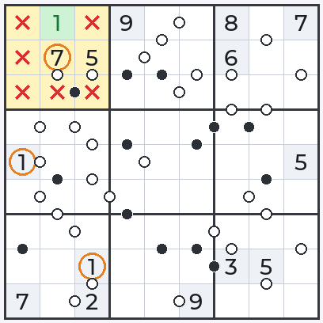

#### Step 2: the 5 in box 3

Box 3 needs a 5. r1c8 and r3c8: column 8 has one (r8c8). r2c8 and r2c9: row 2 has one (r2c3). r3c9: column 9 has one (r5c9). Only **r3c7** is left: **r3c7 = 5**.

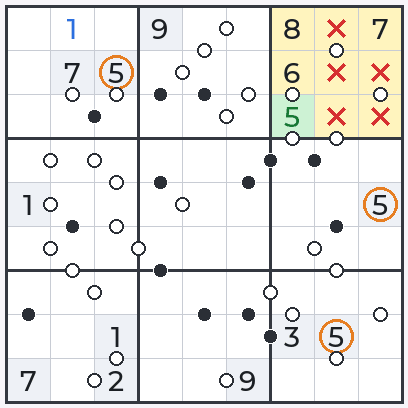

#### Step 3: the 7 in box 9

Box 9 needs a 7. r7c9 and r8c9: column 9 has one (r1c9). r9c7, r9c8 and r9c9: row 9 has one (r9c1). r7c7: a white dot joins it to the 3 in r8c7: it's 2 or 4. Only **r7c8** is left: **r7c8 = 7**.

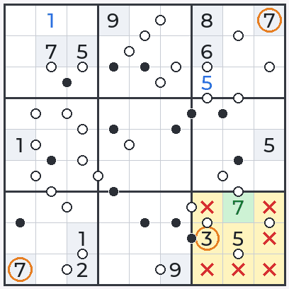

#### Step 4: the 3 in row 9

Row 9 needs a 3. r9c7: column 7 has one (r8c7). r9c8 and r9c9: box 9 has one (r8c7). r9c4: there's no dot between it and the 2 in r9c3: it isn't 1, 3 or 4. r9c5: a white dot joins it to the 9 in r9c6: it's 8. Only **r9c2** is left: **r9c2 = 3**.

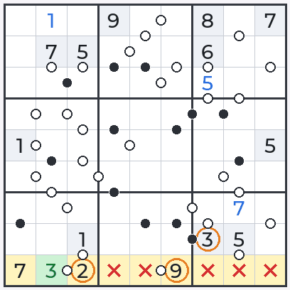

#### Step 5: the 5 in row 9

Row 9 needs a 5. r9c7: column 7 has one (r3c7). r9c8: column 8 has one (r8c8). r9c9: column 9 has one (r5c9). r9c5: a white dot joins it to the 9 in r9c6: it's 8. Only **r9c4** is left: **r9c4 = 5**.

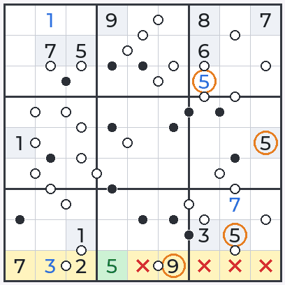

#### Step 6: the 6 in column 9

Column 9 needs a 6. r2c9: row 2 has one (r2c7). r3c9: box 3 has one (r2c7). r4c9 and r6c9: there's no dot between it and the 5 in r5c9: it isn't 4 or 6. r7c9: there's no dot between it and the 7 in r7c8: it isn't 6 or 8. r8c9: there's no dot between it and the 5 in r8c8: it isn't 4 or 6. Only **r9c9** is left: **r9c9 = 6**.

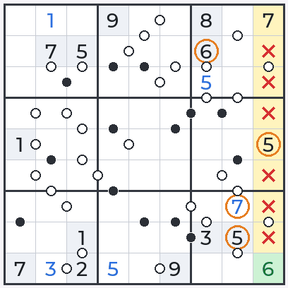

#### Step 7: the 8 in box 9

Box 9 needs an 8. r7c7 and r9c7: column 7 has one (r1c7). r7c9: there's no dot between it and the 7 in r7c8: it isn't 6 or 8. r9c8: a white dot joins it to the 5 in r8c8: it's 4 or 6. Only **r8c9** is left: **r8c9 = 8**.

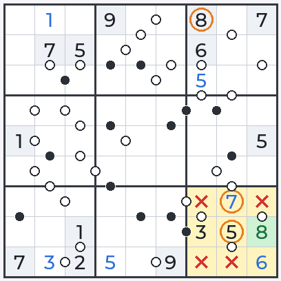

#### Step 8: the 1 in box 9

Box 9 needs a 1. r7c7: a white dot joins it to the 3 in r8c7: it's 2 or 4. r7c9: a white dot joins it to the 8 in r8c9: it's 7 or 9. r9c8: a white dot joins it to the 5 in r8c8: it's 4 or 6. Only **r9c7** is left: **r9c7 = 1**.

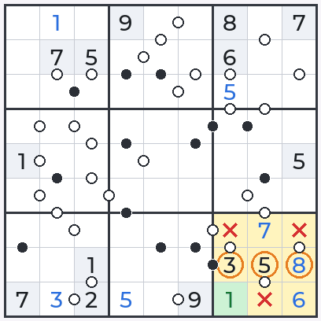

#### Step 9: the 2 in box 9

Box 9 needs a 2. r9c8: row 9 has one (r9c3). r7c9: a white dot joins it to the 8 in r8c9: it's 7 or 9. Only **r7c7** is left: **r7c7 = 2**.

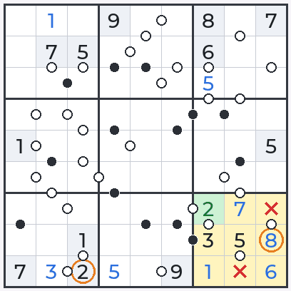

#### Step 10: the 2 in box 8

Box 8 needs a 2. r7c4, r7c5 and r7c6: row 7 has one (r7c7). r9c5: row 9 has one (r9c3). r8c4: there's no dot between it and the 1 in r8c3: it isn't 2. r8c6: a black dot joins it to the 3 in r8c7: it's 6. Only **r8c5** is left: **r8c5 = 2**.

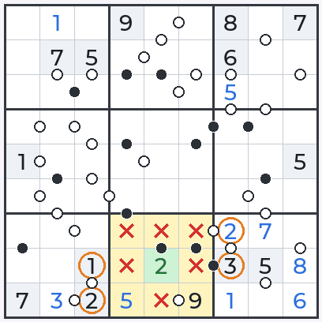

#### Step 11: the 7 in box 8

Box 8 needs a 7. r7c4, r7c5 and r7c6: row 7 has one (r7c8). r9c5: row 9 has one (r9c1). r8c6: a black dot joins it to the 3 in r8c7: it's 6. Only **r8c4** is left: **r8c4 = 7**.

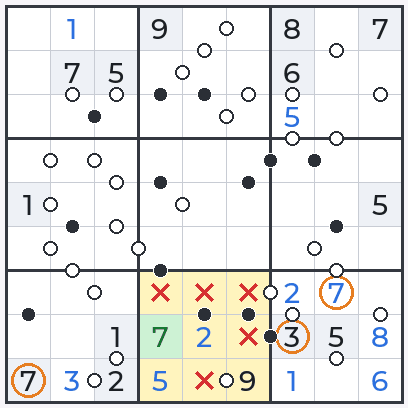

#### Step 12: the 6 in box 8

Box 8 needs a 6. r9c5: row 9 has one (r9c9). r7c4: there's no dot between it and the 7 in r8c4: it isn't 6 or 8. r7c5: a black dot joins it to the 2 in r8c5: it's 4 or 1. r7c6: a white dot joins it to the 2 in r7c7: it's 1 or 3. Only **r8c6** is left: **r8c6 = 6**.

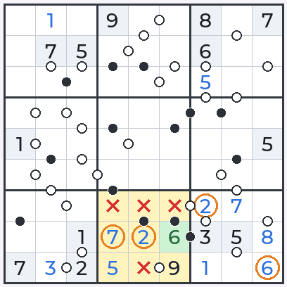

#### Step 13: the 8 in box 8

Box 8 needs an 8. r7c4: there's no dot between it and the 7 in r8c4: it isn't 6 or 8. r7c5: a black dot joins it to the 2 in r8c5: it's 4 or 1. r7c6: a white dot joins it to the 2 in r7c7: it's 1 or 3. Only **r9c5** is left: **r9c5 = 8**.

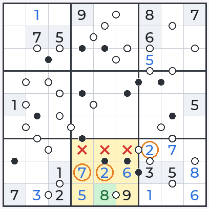

#### Step 14: the 4 in box 9

Box 9 needs a 4. r7c9: a white dot joins it to the 8 in r8c9: it's 7 or 9. Only **r9c8** is left: **r9c8 = 4**.

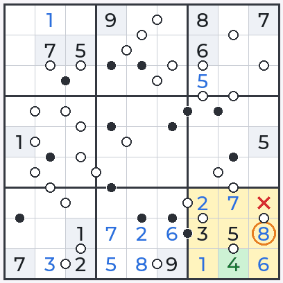

#### Step 15: the 9 in box 9

Box 9 needs a 9, and r7c9 is its last empty cell: **r7c9 = 9**.

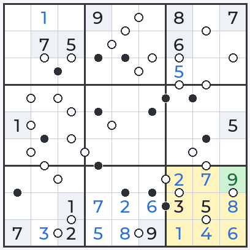

#### Step 16: the 8 in row 2

Row 2 needs an 8. r2c5: column 5 has one (r9c5). r2c8: box 3 has one (r1c7). r2c9: column 9 has one (r8c9). r2c1: there's no dot between it and the 7 in r2c2: it isn't 6 or 8. r2c4: there's no dot between it and the 9 in r1c4: it isn't 8. Only **r2c6** is left: **r2c6 = 8**.

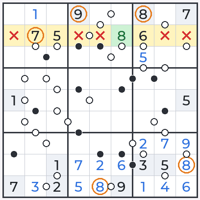

#### Step 17: the 4 in row 8

Row 8 needs a 4. r8c2: there's no dot between it and the 3 in r9c2: it isn't 2, 4 or 6. Only **r8c1** is left: **r8c1 = 4**.

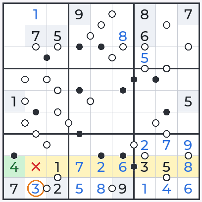

#### Step 18: the 4 in box 1

Box 1 needs a 4. r1c1, r2c1 and r3c1: column 1 has one (r8c1). r1c3: there's no dot between it and the 5 in r2c3: it isn't 4 or 6. r3c2: a white dot joins it to the 7 in r2c2: it's 6 or 8. Only **r3c3** is left: **r3c3 = 4**.

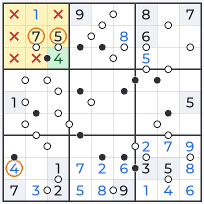

#### Step 19: the 4 in box 2

Box 2 needs a 4. r3c4, r3c5 and r3c6: row 3 has one (r3c3). r1c6: there's no dot between it and the 8 in r1c7: it isn't 4, 7 or 9. r2c4: there's no dot between it and the 5 in r2c3: it isn't 4 or 6. r2c5: there's no dot between it and the 8 in r2c6: it isn't 4, 7 or 9. Only **r1c5** is left: **r1c5 = 4**.

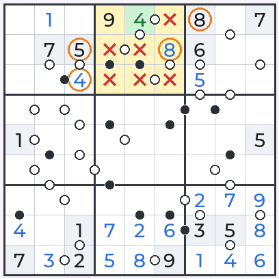

#### Step 20: the 2 in box 2

Box 2 needs a 2. r2c5 and r3c5: column 5 has one (r8c5). r1c6: a white dot joins it to the 4 in r1c5: it's 3 or 5. r3c4: there's no dot between it and the 4 in r3c3: it isn't 2, 3, 5 or 8. r3c6: a white dot joins it to the 8 in r2c6: it's 7 or 9. Only **r2c4** is left: **r2c4 = 2**.

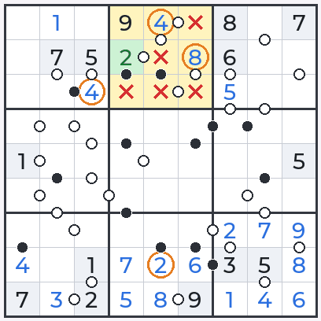

#### Step 21: the 2 in box 1

Box 1 needs a 2. r1c3: column 3 has one (r9c3). r2c1: row 2 has one (r2c4). r1c1: there's no dot between it and the 1 in r1c2: it isn't 2. r3c2: a white dot joins it to the 7 in r2c2: it's 6 or 8. Only **r3c1** is left: **r3c1 = 2**.

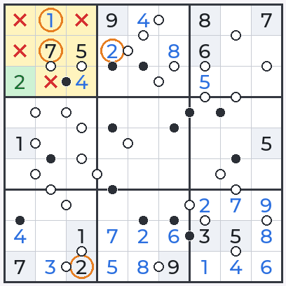

#### Step 22: the 6 in box 1

Box 1 needs a 6. r2c1: row 2 has one (r2c7). r1c3: there's no dot between it and the 5 in r2c3: it isn't 4 or 6. r3c2: a black dot joins it to the 4 in r3c3: it's 8 or 2. Only **r1c1** is left: **r1c1 = 6**.

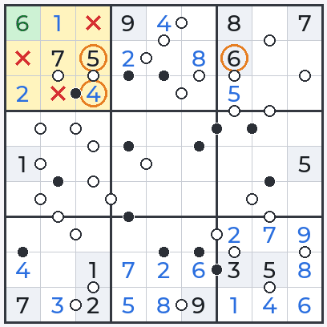

#### Step 23: the 3 in box 1

Box 1 needs a 3. r3c2: column 2 has one (r9c2). r2c1: there's no dot between it and the 6 in r1c1: it isn't 3, 5 or 7. Only **r1c3** is left: **r1c3 = 3**.

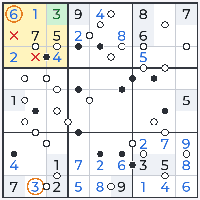

#### Step 24: the 8 in box 1

Box 1 needs an 8. r2c1: row 2 has one (r2c6). Only **r3c2** is left: **r3c2 = 8**.

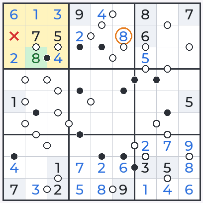

#### Step 25: the 9 in box 1

Box 1 needs a 9, and r2c1 is its last empty cell: **r2c1 = 9**.

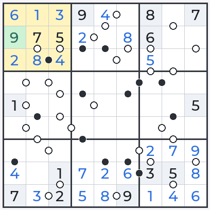

#### Step 26: the 5 in box 2

Box 2 needs a 5. r2c5: row 2 has one (r2c3). r3c4, r3c5 and r3c6: row 3 has one (r3c7). Only **r1c6** is left: **r1c6 = 5**.

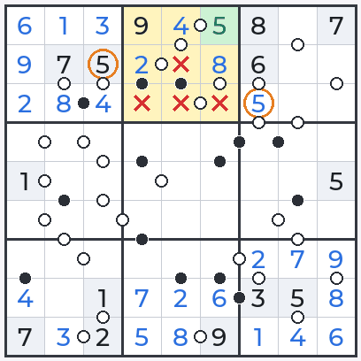

#### Step 27: the 6 in box 2

Box 2 needs a 6. r2c5: row 2 has one (r2c7). r3c6: column 6 has one (r8c6). r3c4: a black dot joins it to the 2 in r2c4: it's 4 or 1. Only **r3c5** is left: **r3c5 = 6**.

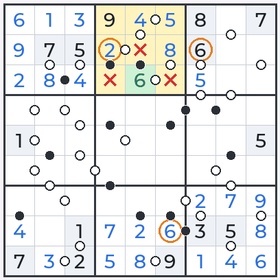

#### Step 28: the 1 in box 2

Box 2 needs a 1. r2c5: a white dot joins it to the 4 in r1c5: it's 3 or 5. r3c6: a white dot joins it to the 6 in r3c5: it's 5 or 7. Only **r3c4** is left: **r3c4 = 1**.

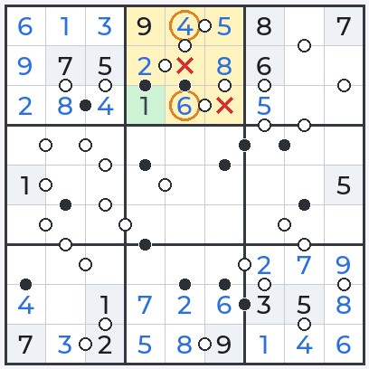

#### Step 29: the 3 in box 2

Box 2 needs a 3. r3c6: a white dot joins it to the 6 in r3c5: it's 5 or 7. Only **r2c5** is left: **r2c5 = 3**.

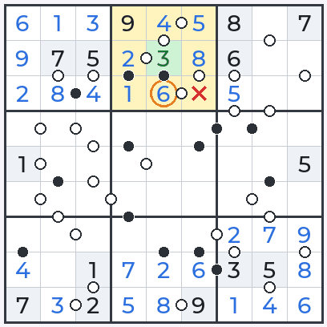

#### Step 30: the 7 in box 2

Box 2 needs a 7, and r3c6 is its last empty cell: **r3c6 = 7**.

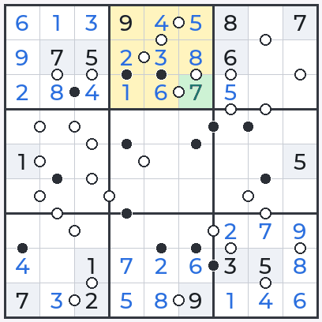

#### Step 31: the 2 in box 3

Box 3 needs a 2. r2c8 and r2c9: row 2 has one (r2c4). r3c8 and r3c9: row 3 has one (r3c1). Only **r1c8** is left: **r1c8 = 2**.

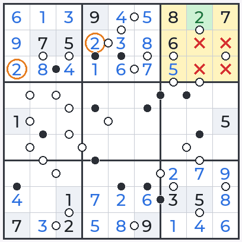

#### Step 32: the 4 in box 3

Box 3 needs a 4. r2c8: column 8 has one (r9c8). r3c8 and r3c9: row 3 has one (r3c3). Only **r2c9** is left: **r2c9 = 4**.

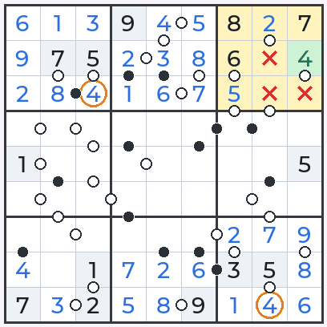

#### Step 33: the 1 in box 3

Box 3 needs a 1. r3c8 and r3c9: row 3 has one (r3c4). Only **r2c8** is left: **r2c8 = 1**.

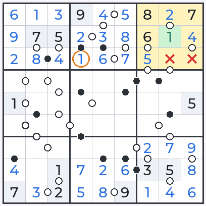

#### Step 34: the 9 in box 3

Box 3 needs a 9. r3c9: column 9 has one (r7c9). Only **r3c8** is left: **r3c8 = 9**.

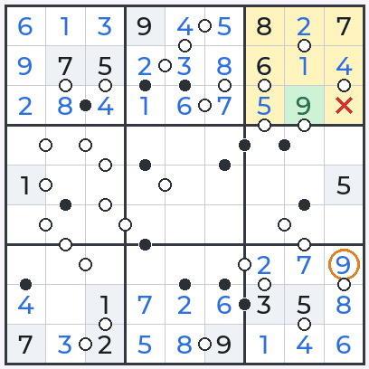

#### Step 35: the 3 in box 3

Box 3 needs a 3, and r3c9 is its last empty cell: **r3c9 = 3**.

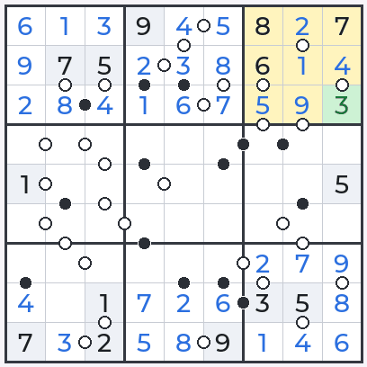

#### Step 36: the 3 in box 4

Box 4 needs a 3. r4c2, r5c2 and r6c2: column 2 has one (r9c2). r4c3, r5c3 and r6c3: column 3 has one (r1c3). r4c1: there's no dot between it and the 2 in r3c1: it isn't 1, 3 or 4. Only **r6c1** is left: **r6c1 = 3**.

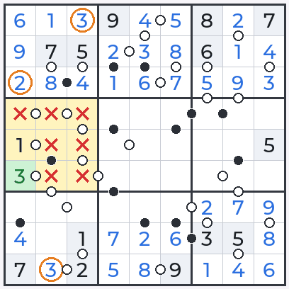

#### Step 37: the 4 in box 4

Box 4 needs a 4. r4c1: column 1 has one (r8c1). r4c3, r5c3 and r6c3: column 3 has one (r3c3). r4c2: there's no dot between it and the 8 in r3c2: it isn't 4, 7 or 9. r5c2: a white dot joins it to the 1 in r5c1: it's 2. Only **r6c2** is left: **r6c2 = 4**.

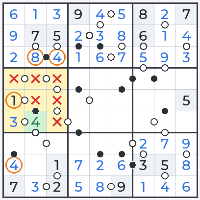

#### Step 38: the 5 in box 5

Box 5 needs a 5. r4c4 and r6c4: column 4 has one (r9c4). r4c6 and r6c6: column 6 has one (r1c6). r5c4, r5c5 and r5c6: row 5 has one (r5c9). r4c5: there's no dot between it and the 6 in r3c5: it isn't 3, 5 or 7. Only **r6c5** is left: **r6c5 = 5**.

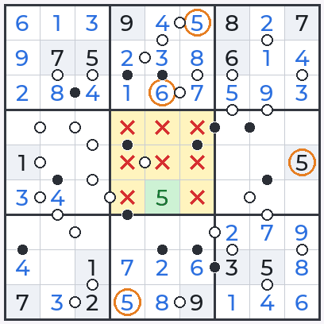

#### Step 39: the 7 in box 5

Box 5 needs a 7. r4c4, r5c4 and r6c4: column 4 has one (r8c4). r4c6, r5c6 and r6c6: column 6 has one (r3c6). r4c5: there's no dot between it and the 6 in r3c5: it isn't 3, 5 or 7. Only **r5c5** is left: **r5c5 = 7**.

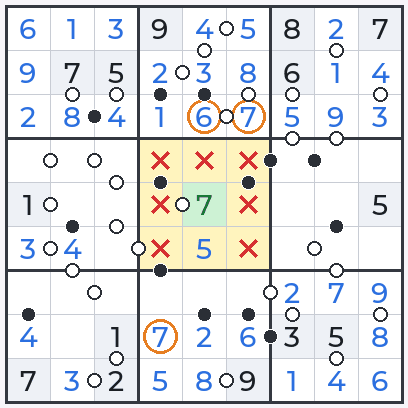

#### Step 40: the 9 in box 5

Box 5 needs a 9. r4c4, r5c4 and r6c4: column 4 has one (r1c4). r4c6, r5c6 and r6c6: column 6 has one (r9c6). Only **r4c5** is left: **r4c5 = 9**.

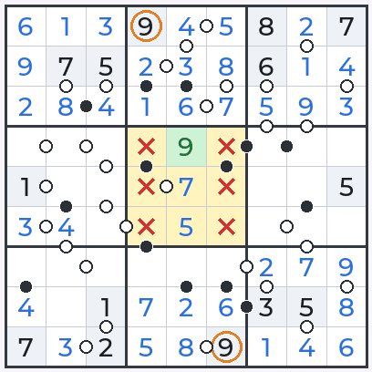

#### Step 41: the 2 in box 6

Box 6 needs a 2. r4c7, r5c7 and r6c7: column 7 has one (r7c7). r4c8, r5c8 and r6c8: column 8 has one (r1c8). r4c9: there's no dot between it and the 3 in r3c9: it isn't 2, 4 or 6. Only **r6c9** is left: **r6c9 = 2**.

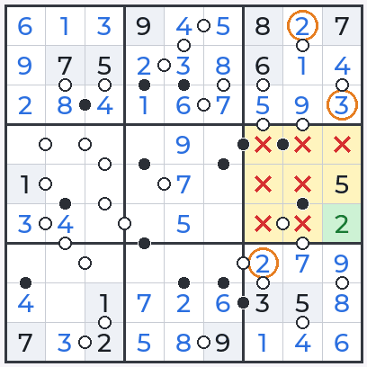

#### Step 42: the 1 in box 6

Box 6 needs a 1. r4c7 and r6c7: column 7 has one (r9c7). r4c8 and r6c8: column 8 has one (r2c8). r5c7 and r5c8: row 5 has one (r5c1). Only **r4c9** is left: **r4c9 = 1**.

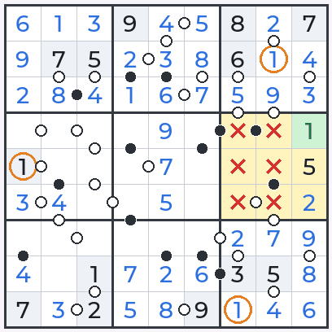

#### Step 43: the 1 in box 5

Box 5 needs a 1. r4c4 and r4c6: row 4 has one (r4c9). r5c4 and r5c6: row 5 has one (r5c1). r6c4: column 4 has one (r3c4). Only **r6c6** is left: **r6c6 = 1**.

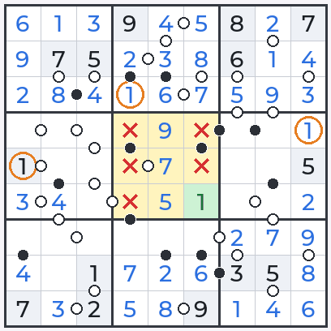

#### Step 44: the 2 in box 5

Box 5 needs a 2. r4c4 and r5c4: column 4 has one (r2c4). r6c4: row 6 has one (r6c9). r5c6: there's no dot between it and the 1 in r6c6: it isn't 2. Only **r4c6** is left: **r4c6 = 2**.

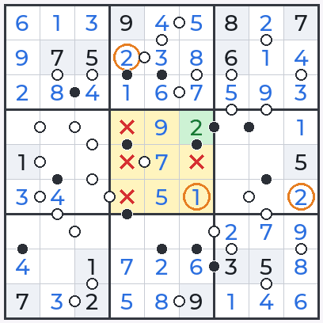

#### Step 45: the 2 in box 4

Box 4 needs a 2. r4c1, r4c2 and r4c3: row 4 has one (r4c6). r5c3: column 3 has one (r9c3). r6c3: row 6 has one (r6c9). Only **r5c2** is left: **r5c2 = 2**.

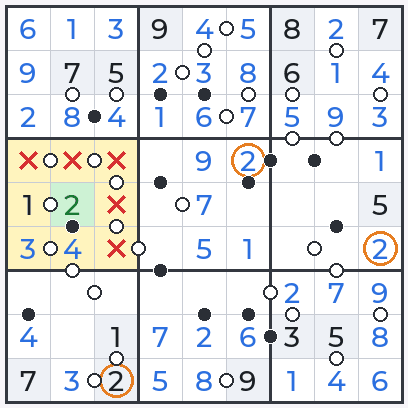

#### Step 46: the 3 in box 5

Box 5 needs a 3. r6c4: row 6 has one (r6c1). r5c4: a white dot joins it to the 7 in r5c5: it's 6 or 8. r5c6: a black dot joins it to the 2 in r4c6: it's 4 or 1. Only **r4c4** is left: **r4c4 = 3**.

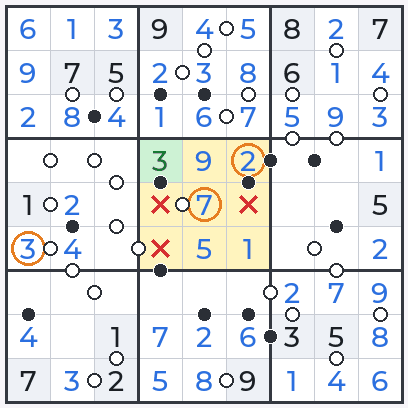

#### Step 47: the 4 in box 5

Box 5 needs a 4. r6c4: row 6 has one (r6c2). r5c4: a white dot joins it to the 7 in r5c5: it's 6 or 8. Only **r5c6** is left: **r5c6 = 4**.

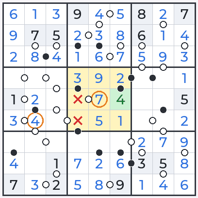

#### Step 48: the 6 in box 5

Box 5 needs a 6. r6c4: there's no dot between it and the 5 in r6c5: it isn't 4 or 6. Only **r5c4** is left: **r5c4 = 6**.

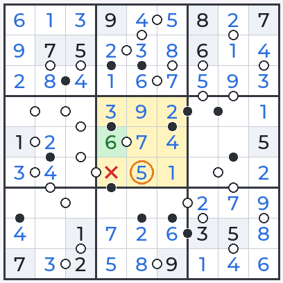

#### Step 49: the 8 in box 5

Box 5 needs an 8, and r6c4 is its last empty cell: **r6c4 = 8**.

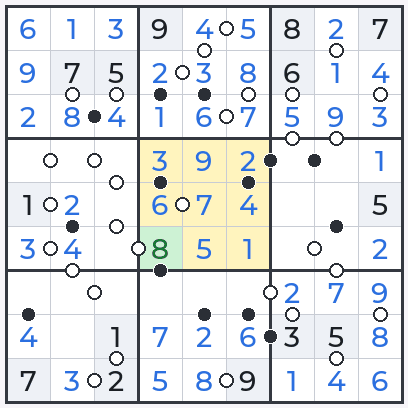

#### Step 50: the 6 in box 4

Box 4 needs a 6. r4c1: column 1 has one (r1c1). r5c3: row 5 has one (r5c4). r4c3: there's no dot between it and the 3 in r4c4: it isn't 2, 4 or 6. r6c3: a white dot joins it to the 8 in r6c4: it's 7 or 9. Only **r4c2** is left: **r4c2 = 6**.

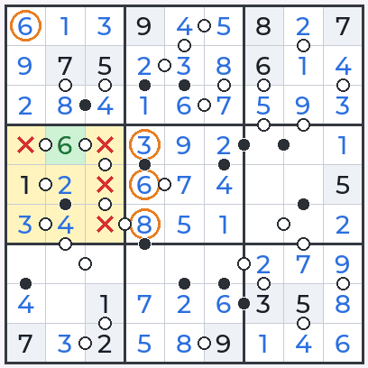

#### Step 51: the 5 in box 4

Box 4 needs a 5. r4c3: column 3 has one (r2c3). r5c3: row 5 has one (r5c9). r6c3: row 6 has one (r6c5). Only **r4c1** is left: **r4c1 = 5**.


#### Step 52: the 8 in box 4

Box 4 needs an 8. r6c3: row 6 has one (r6c4). r4c3: a white dot joins it to the 6 in r4c2: it's 5 or 7. Only **r5c3** is left: **r5c3 = 8**.


#### Step 53: the 9 in box 4

Box 4 needs a 9. r4c3: row 4 has one (r4c5). Only **r6c3** is left: **r6c3 = 9**.


#### Step 54: the 7 in box 4

Box 4 needs a 7, and r4c3 is its last empty cell: **r4c3 = 7**.


#### Step 55: the 3 in box 6

Box 6 needs a 3. r4c7 and r4c8: row 4 has one (r4c4). r5c7: column 7 has one (r8c7). r6c7 and r6c8: row 6 has one (r6c1). Only **r5c8** is left: **r5c8 = 3**.


#### Step 56: the 4 in box 6

Box 6 needs a 4. r4c8: column 8 has one (r9c8). r5c7: row 5 has one (r5c6). r6c7 and r6c8: row 6 has one (r6c2). Only **r4c7** is left: **r4c7 = 4**.


#### Step 57: the 6 in box 6

Box 6 needs a 6. r4c8: row 4 has one (r4c2). r5c7: row 5 has one (r5c4). r6c7: column 7 has one (r2c7). Only **r6c8** is left: **r6c8 = 6**.


#### Step 58: the 7 in box 6

Box 6 needs a 7. r4c8: row 4 has one (r4c3). r5c7: row 5 has one (r5c5). Only **r6c7** is left: **r6c7 = 7**.


#### Step 59: the 8 in box 6

Box 6 needs an 8. r5c7: row 5 has one (r5c3). Only **r4c8** is left: **r4c8 = 8**.


#### Step 60: the 9 in box 6

Box 6 needs a 9, and r5c7 is its last empty cell: **r5c7 = 9**.


#### Step 61: the 5 in box 7

Box 7 needs a 5. r7c1: column 1 has one (r4c1). r7c3: column 3 has one (r2c3). r8c2: row 8 has one (r8c8). Only **r7c2** is left: **r7c2 = 5**.


#### Step 62: the 6 in box 7

Box 7 needs a 6. r7c1: column 1 has one (r1c1). r8c2: row 8 has one (r8c6). Only **r7c3** is left: **r7c3 = 6**.


#### Step 63: the 8 in box 7

Box 7 needs an 8. r8c2: row 8 has one (r8c9). Only **r7c1** is left: **r7c1 = 8**.


#### Step 64: the 9 in box 7

Box 7 needs a 9, and r8c2 is its last empty cell: **r8c2 = 9**.


#### Step 65: the 1 in box 8

Box 8 needs a 1. r7c4: column 4 has one (r3c4). r7c6: column 6 has one (r6c6). Only **r7c5** is left: **r7c5 = 1**.


#### Step 66: the 3 in box 8

Box 8 needs a 3. r7c4: column 4 has one (r4c4). Only **r7c6** is left: **r7c6 = 3**.


#### Step 67: the 4 in box 8

Box 8 needs a 4, and r7c4 is its last empty cell: **r7c4 = 4**.


Solved.

<!-- /walkthrough -->
