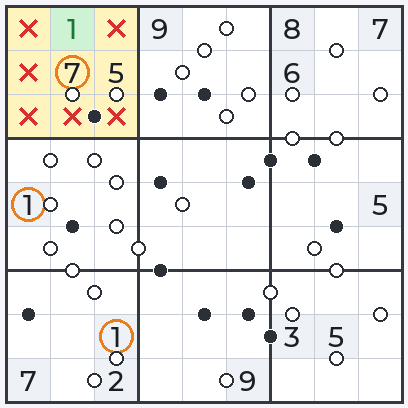

<!-- Written by tools/walkthrough.py kropki: edit the script, not this page. -->
# Kropki, step 1: the 1 in box 1

**Step 1 of 67** · [← The start](../kropki.md#the-whole-puzzle-step-by-step) · [All steps](../kropki.md#the-whole-puzzle-step-by-step) · [Step 2 →](step-02.md)

Box 1 needs a 1. r1c1, r2c1 and r3c1: column 1 has one (r5c1). r1c3 and r3c3: column 3 has one (r8c3). r3c2: a white dot joins it to the 7 in r2c2: it's 6 or 8. Only **r1c2** is left: **r1c2 = 1**.

**Step 1 of 67** · [← The start](../kropki.md#the-whole-puzzle-step-by-step) · [All steps](../kropki.md#the-whole-puzzle-step-by-step) · [Step 2 →](step-02.md)
