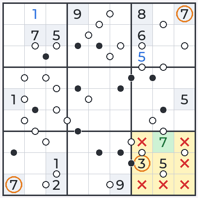

<!-- Written by tools/walkthrough.py kropki: edit the script, not this page. -->
# Kropki, step 3: the 7 in box 9

**Step 3 of 67** · [← Step 2](step-02.md) · [All steps](../kropki.md#the-whole-puzzle-step-by-step) · [Step 4 →](step-04.md)

Box 9 needs a 7. r7c9 and r8c9: column 9 has one (r1c9). r9c7, r9c8 and r9c9: row 9 has one (r9c1). r7c7: a white dot joins it to the 3 in r8c7: it's 2 or 4. Only **r7c8** is left: **r7c8 = 7**.

**Step 3 of 67** · [← Step 2](step-02.md) · [All steps](../kropki.md#the-whole-puzzle-step-by-step) · [Step 4 →](step-04.md)
