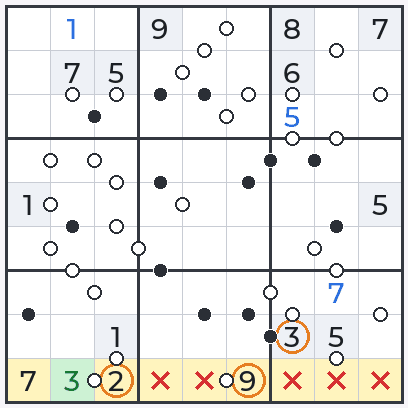

<!-- Written by tools/walkthrough.py kropki: edit the script, not this page. -->
# Kropki, step 4: the 3 in row 9

**Step 4 of 67** · [← Step 3](step-03.md) · [All steps](../kropki.md#the-whole-puzzle-step-by-step) · [Step 5 →](step-05.md)

Row 9 needs a 3. r9c7: column 7 has one (r8c7). r9c8 and r9c9: box 9 has one (r8c7). r9c4: there's no dot between it and the 2 in r9c3: it isn't 1, 3 or 4. r9c5: a white dot joins it to the 9 in r9c6: it's 8. Only **r9c2** is left: **r9c2 = 3**.

**Step 4 of 67** · [← Step 3](step-03.md) · [All steps](../kropki.md#the-whole-puzzle-step-by-step) · [Step 5 →](step-05.md)
