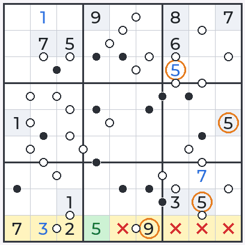

<!-- Written by tools/walkthrough.py kropki: edit the script, not this page. -->
# Kropki, step 5: the 5 in row 9

**Step 5 of 67** · [← Step 4](step-04.md) · [All steps](../kropki.md#the-whole-puzzle-step-by-step) · [Step 6 →](step-06.md)

Row 9 needs a 5. r9c7: column 7 has one (r3c7). r9c8: column 8 has one (r8c8). r9c9: column 9 has one (r5c9). r9c5: a white dot joins it to the 9 in r9c6: it's 8. Only **r9c4** is left: **r9c4 = 5**.

**Step 5 of 67** · [← Step 4](step-04.md) · [All steps](../kropki.md#the-whole-puzzle-step-by-step) · [Step 6 →](step-06.md)
