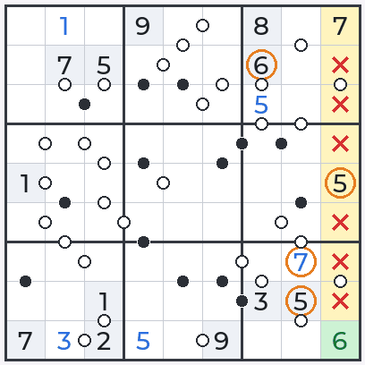

<!-- Written by tools/walkthrough.py kropki: edit the script, not this page. -->
# Kropki, step 6: the 6 in column 9

**Step 6 of 67** · [← Step 5](step-05.md) · [All steps](../kropki.md#the-whole-puzzle-step-by-step) · [Step 7 →](step-07.md)

Column 9 needs a 6. r2c9: row 2 has one (r2c7). r3c9: box 3 has one (r2c7). r4c9 and r6c9: there's no dot between it and the 5 in r5c9: it isn't 4 or 6. r7c9: there's no dot between it and the 7 in r7c8: it isn't 6 or 8. r8c9: there's no dot between it and the 5 in r8c8: it isn't 4 or 6. Only **r9c9** is left: **r9c9 = 6**.

**Step 6 of 67** · [← Step 5](step-05.md) · [All steps](../kropki.md#the-whole-puzzle-step-by-step) · [Step 7 →](step-07.md)
