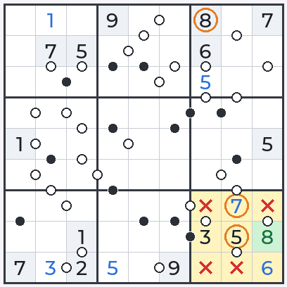

<!-- Written by tools/walkthrough.py kropki: edit the script, not this page. -->
# Kropki, step 7: the 8 in box 9

**Step 7 of 67** · [← Step 6](step-06.md) · [All steps](../kropki.md#the-whole-puzzle-step-by-step) · [Step 8 →](step-08.md)

Box 9 needs an 8. r7c7 and r9c7: column 7 has one (r1c7). r7c9: there's no dot between it and the 7 in r7c8: it isn't 6 or 8. r9c8: a white dot joins it to the 5 in r8c8: it's 4 or 6. Only **r8c9** is left: **r8c9 = 8**.

**Step 7 of 67** · [← Step 6](step-06.md) · [All steps](../kropki.md#the-whole-puzzle-step-by-step) · [Step 8 →](step-08.md)
