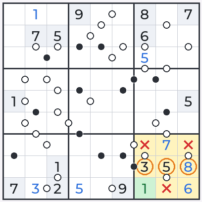

<!-- Written by tools/walkthrough.py kropki: edit the script, not this page. -->
# Kropki, step 8: the 1 in box 9

**Step 8 of 67** · [← Step 7](step-07.md) · [All steps](../kropki.md#the-whole-puzzle-step-by-step) · [Step 9 →](step-09.md)

Box 9 needs a 1. r7c7: a white dot joins it to the 3 in r8c7: it's 2 or 4. r7c9: a white dot joins it to the 8 in r8c9: it's 7 or 9. r9c8: a white dot joins it to the 5 in r8c8: it's 4 or 6. Only **r9c7** is left: **r9c7 = 1**.

**Step 8 of 67** · [← Step 7](step-07.md) · [All steps](../kropki.md#the-whole-puzzle-step-by-step) · [Step 9 →](step-09.md)
