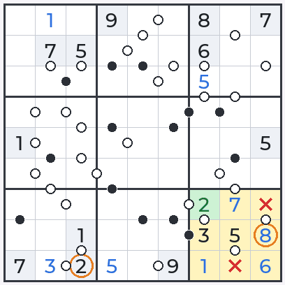

<!-- Written by tools/walkthrough.py kropki: edit the script, not this page. -->
# Kropki, step 9: the 2 in box 9

**Step 9 of 67** · [← Step 8](step-08.md) · [All steps](../kropki.md#the-whole-puzzle-step-by-step) · [Step 10 →](step-10.md)

Box 9 needs a 2. r9c8: row 9 has one (r9c3). r7c9: a white dot joins it to the 8 in r8c9: it's 7 or 9. Only **r7c7** is left: **r7c7 = 2**.

**Step 9 of 67** · [← Step 8](step-08.md) · [All steps](../kropki.md#the-whole-puzzle-step-by-step) · [Step 10 →](step-10.md)
