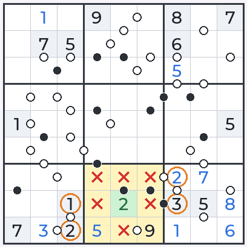

<!-- Written by tools/walkthrough.py kropki: edit the script, not this page. -->
# Kropki, step 10: the 2 in box 8

**Step 10 of 67** · [← Step 9](step-09.md) · [All steps](../kropki.md#the-whole-puzzle-step-by-step) · [Step 11 →](step-11.md)

Box 8 needs a 2. r7c4, r7c5 and r7c6: row 7 has one (r7c7). r9c5: row 9 has one (r9c3). r8c4: there's no dot between it and the 1 in r8c3: it isn't 2. r8c6: a black dot joins it to the 3 in r8c7: it's 6. Only **r8c5** is left: **r8c5 = 2**.

**Step 10 of 67** · [← Step 9](step-09.md) · [All steps](../kropki.md#the-whole-puzzle-step-by-step) · [Step 11 →](step-11.md)
