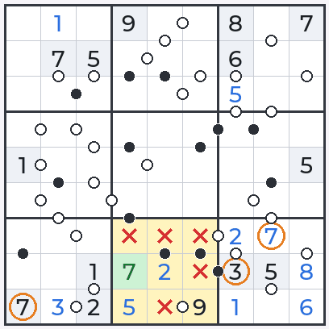

<!-- Written by tools/walkthrough.py kropki: edit the script, not this page. -->
# Kropki, step 11: the 7 in box 8

**Step 11 of 67** · [← Step 10](step-10.md) · [All steps](../kropki.md#the-whole-puzzle-step-by-step) · [Step 12 →](step-12.md)

Box 8 needs a 7. r7c4, r7c5 and r7c6: row 7 has one (r7c8). r9c5: row 9 has one (r9c1). r8c6: a black dot joins it to the 3 in r8c7: it's 6. Only **r8c4** is left: **r8c4 = 7**.

**Step 11 of 67** · [← Step 10](step-10.md) · [All steps](../kropki.md#the-whole-puzzle-step-by-step) · [Step 12 →](step-12.md)
