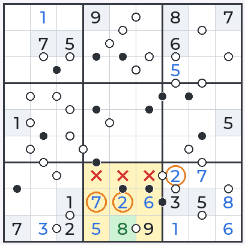

<!-- Written by tools/walkthrough.py kropki: edit the script, not this page. -->
# Kropki, step 13: the 8 in box 8

**Step 13 of 67** · [← Step 12](step-12.md) · [All steps](../kropki.md#the-whole-puzzle-step-by-step) · [Step 14 →](step-14.md)

Box 8 needs an 8. r7c4: there's no dot between it and the 7 in r8c4: it isn't 6 or 8. r7c5: a black dot joins it to the 2 in r8c5: it's 4 or 1. r7c6: a white dot joins it to the 2 in r7c7: it's 1 or 3. Only **r9c5** is left: **r9c5 = 8**.

**Step 13 of 67** · [← Step 12](step-12.md) · [All steps](../kropki.md#the-whole-puzzle-step-by-step) · [Step 14 →](step-14.md)
