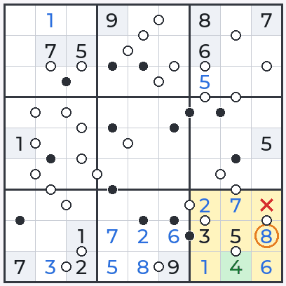

<!-- Written by tools/walkthrough.py kropki: edit the script, not this page. -->
# Kropki, step 14: the 4 in box 9

**Step 14 of 67** · [← Step 13](step-13.md) · [All steps](../kropki.md#the-whole-puzzle-step-by-step) · [Step 15 →](step-15.md)

Box 9 needs a 4. r7c9: a white dot joins it to the 8 in r8c9: it's 7 or 9. Only **r9c8** is left: **r9c8 = 4**.

**Step 14 of 67** · [← Step 13](step-13.md) · [All steps](../kropki.md#the-whole-puzzle-step-by-step) · [Step 15 →](step-15.md)
