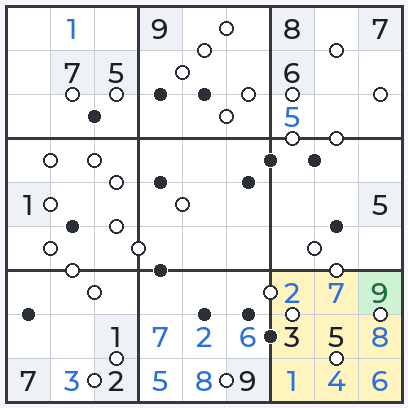

<!-- Written by tools/walkthrough.py kropki: edit the script, not this page. -->
# Kropki, step 15: the 9 in box 9

**Step 15 of 67** · [← Step 14](step-14.md) · [All steps](../kropki.md#the-whole-puzzle-step-by-step) · [Step 16 →](step-16.md)

Box 9 needs a 9, and r7c9 is its last empty cell: **r7c9 = 9**.

**Step 15 of 67** · [← Step 14](step-14.md) · [All steps](../kropki.md#the-whole-puzzle-step-by-step) · [Step 16 →](step-16.md)
