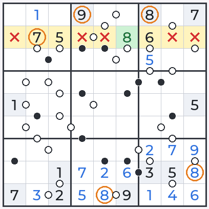

<!-- Written by tools/walkthrough.py kropki: edit the script, not this page. -->
# Kropki, step 16: the 8 in row 2

**Step 16 of 67** · [← Step 15](step-15.md) · [All steps](../kropki.md#the-whole-puzzle-step-by-step) · [Step 17 →](step-17.md)

Row 2 needs an 8. r2c5: column 5 has one (r9c5). r2c8: box 3 has one (r1c7). r2c9: column 9 has one (r8c9). r2c1: there's no dot between it and the 7 in r2c2: it isn't 6 or 8. r2c4: there's no dot between it and the 9 in r1c4: it isn't 8. Only **r2c6** is left: **r2c6 = 8**.

**Step 16 of 67** · [← Step 15](step-15.md) · [All steps](../kropki.md#the-whole-puzzle-step-by-step) · [Step 17 →](step-17.md)
