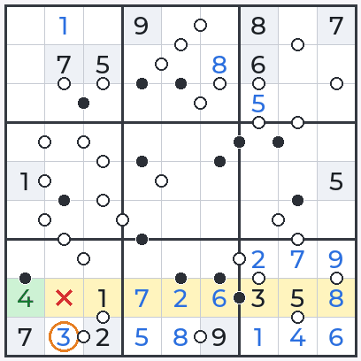

<!-- Written by tools/walkthrough.py kropki: edit the script, not this page. -->
# Kropki, step 17: the 4 in row 8

**Step 17 of 67** · [← Step 16](step-16.md) · [All steps](../kropki.md#the-whole-puzzle-step-by-step) · [Step 18 →](step-18.md)

Row 8 needs a 4. r8c2: there's no dot between it and the 3 in r9c2: it isn't 2, 4 or 6. Only **r8c1** is left: **r8c1 = 4**.

**Step 17 of 67** · [← Step 16](step-16.md) · [All steps](../kropki.md#the-whole-puzzle-step-by-step) · [Step 18 →](step-18.md)
