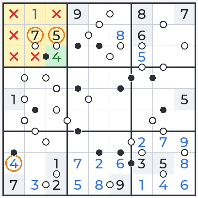

<!-- Written by tools/walkthrough.py kropki: edit the script, not this page. -->
# Kropki, step 18: the 4 in box 1

**Step 18 of 67** · [← Step 17](step-17.md) · [All steps](../kropki.md#the-whole-puzzle-step-by-step) · [Step 19 →](step-19.md)

Box 1 needs a 4. r1c1, r2c1 and r3c1: column 1 has one (r8c1). r1c3: there's no dot between it and the 5 in r2c3: it isn't 4 or 6. r3c2: a white dot joins it to the 7 in r2c2: it's 6 or 8. Only **r3c3** is left: **r3c3 = 4**.

**Step 18 of 67** · [← Step 17](step-17.md) · [All steps](../kropki.md#the-whole-puzzle-step-by-step) · [Step 19 →](step-19.md)
