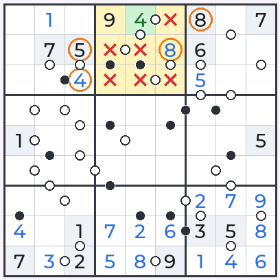

<!-- Written by tools/walkthrough.py kropki: edit the script, not this page. -->
# Kropki, step 19: the 4 in box 2

**Step 19 of 67** · [← Step 18](step-18.md) · [All steps](../kropki.md#the-whole-puzzle-step-by-step) · [Step 20 →](step-20.md)

Box 2 needs a 4. r3c4, r3c5 and r3c6: row 3 has one (r3c3). r1c6: there's no dot between it and the 8 in r1c7: it isn't 4, 7 or 9. r2c4: there's no dot between it and the 5 in r2c3: it isn't 4 or 6. r2c5: there's no dot between it and the 8 in r2c6: it isn't 4, 7 or 9. Only **r1c5** is left: **r1c5 = 4**.

**Step 19 of 67** · [← Step 18](step-18.md) · [All steps](../kropki.md#the-whole-puzzle-step-by-step) · [Step 20 →](step-20.md)
