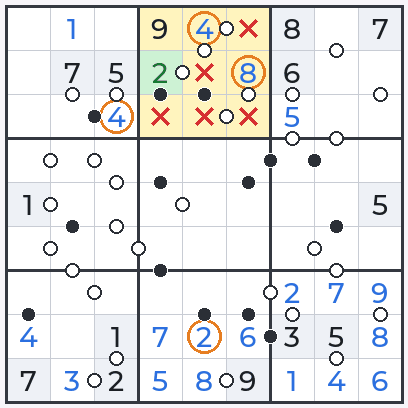

<!-- Written by tools/walkthrough.py kropki: edit the script, not this page. -->
# Kropki, step 20: the 2 in box 2

**Step 20 of 67** · [← Step 19](step-19.md) · [All steps](../kropki.md#the-whole-puzzle-step-by-step) · [Step 21 →](step-21.md)

Box 2 needs a 2. r2c5 and r3c5: column 5 has one (r8c5). r1c6: a white dot joins it to the 4 in r1c5: it's 3 or 5. r3c4: there's no dot between it and the 4 in r3c3: it isn't 2, 3, 5 or 8. r3c6: a white dot joins it to the 8 in r2c6: it's 7 or 9. Only **r2c4** is left: **r2c4 = 2**.

**Step 20 of 67** · [← Step 19](step-19.md) · [All steps](../kropki.md#the-whole-puzzle-step-by-step) · [Step 21 →](step-21.md)
