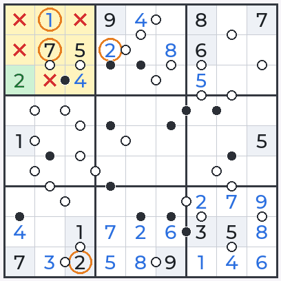

<!-- Written by tools/walkthrough.py kropki: edit the script, not this page. -->
# Kropki, step 21: the 2 in box 1

**Step 21 of 67** · [← Step 20](step-20.md) · [All steps](../kropki.md#the-whole-puzzle-step-by-step) · [Step 22 →](step-22.md)

Box 1 needs a 2. r1c3: column 3 has one (r9c3). r2c1: row 2 has one (r2c4). r1c1: there's no dot between it and the 1 in r1c2: it isn't 2. r3c2: a white dot joins it to the 7 in r2c2: it's 6 or 8. Only **r3c1** is left: **r3c1 = 2**.

**Step 21 of 67** · [← Step 20](step-20.md) · [All steps](../kropki.md#the-whole-puzzle-step-by-step) · [Step 22 →](step-22.md)
