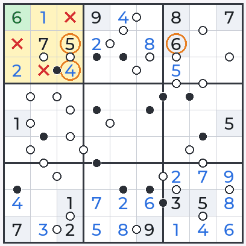

<!-- Written by tools/walkthrough.py kropki: edit the script, not this page. -->
# Kropki, step 22: the 6 in box 1

**Step 22 of 67** · [← Step 21](step-21.md) · [All steps](../kropki.md#the-whole-puzzle-step-by-step) · [Step 23 →](step-23.md)

Box 1 needs a 6. r2c1: row 2 has one (r2c7). r1c3: there's no dot between it and the 5 in r2c3: it isn't 4 or 6. r3c2: a black dot joins it to the 4 in r3c3: it's 8 or 2. Only **r1c1** is left: **r1c1 = 6**.

**Step 22 of 67** · [← Step 21](step-21.md) · [All steps](../kropki.md#the-whole-puzzle-step-by-step) · [Step 23 →](step-23.md)
